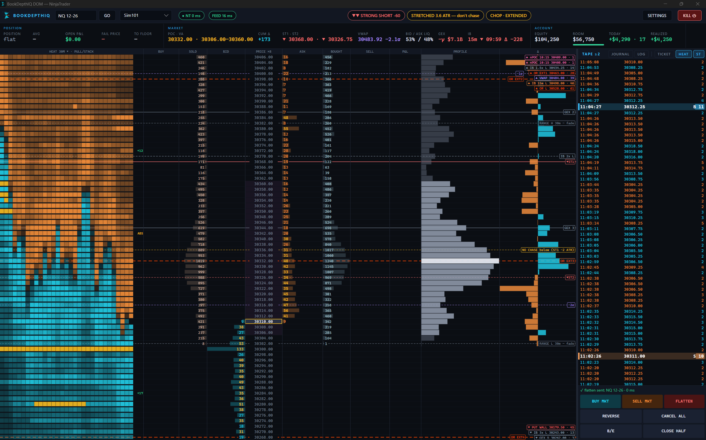

# BookDepthIQ-NT

A modern standalone pop-out **DOM for NinjaTrader 8**, built with **Avalonia** (.NET 8). It is a full
port of the [BookDepthIQ-Vest](https://github.com/autopilotaitech/BookDepthIQ-Vest) panel, with the
same ladder, look, reads and click behaviour. Risk is worked out in **CME contracts, ticks and tick
value, with commissions**, and against **your prop firm's drawdown rules**.



```
┌──────────────── NinjaTrader 8 ────────────────┐                ┌──────── BookDepthIQ DOM (Avalonia) ────────┐
│ your connection (Rithmic / CQG / NT Brokerage)│                │ ladder · reads · tape · journal · order log │
│ BookDepthIQBridge AddOn: depth, prints,       │── 127.0.0.1 ──▶│ CME risk ticket · settings                  │
│   history, account, positions, orders, fills  │◀── commands ───│ every order = your click                    │
└───────────────────────────────────────────────┘                └─────────────────────────────────────────────┘
```

The DOM runs in its own process. If it crashes, NinjaTrader and your orders are not affected. The
bridge is a thin AddOn: it streams data and executes what the DOM sends. It never decides to trade.

> **Status: beta, test on Sim101 first.** The bridge compiles against NinjaTrader 8.1.x. The DOM has
> run against a simulated feed. Run it on Sim101 before any funded account.

## Install

1. **Bridge:** copy `nt8/AddOns/BookDepthIQBridge.cs` to
   `Documents\NinjaTrader 8\bin\Custom\AddOns\`. In NinjaTrader open **New → NinjaScript Editor**
   and press **F5**. It listens on `127.0.0.1:36971` only. After an update, copy it again and press F5.
2. **DOM:** `dotnet run --project src/Dom` (needs the [.NET 8 SDK](https://dotnet.microsoft.com)).
   The header shows **● NT** when it is connected, with the median time NinjaTrader takes to answer.
3. Type the instrument (for example `NQ 12-26`) and press **Go**, then pick **Sim101**. The DOM
   loads up to 48 h of NinjaTrader tick history so SuperTrend, VWAP, the opening range and the
   profile are right from the start.

## Layout

The ladder runs the full height on the left. The right column holds, from top to bottom:

- **TAPE**, with **journal** and **log** buttons that swap the view (click again for the tape), plus
  **heat** and **ST** toggles.
- **TICKET** (hide it with the **ticket** button in the tape toolbar; hidden = tape and buttons only):
  a **READOUT** of contracts · risk · win · R:R · % of room · losers left in big type, with the cost,
  warning and result lines. Under it are cards with segmented controls and pill toggles: **SIZE**,
  **STOP** (ticks / ATR / swing + BRACKET), **TARGETS** (TP1–3 + split), **MANAGE** (B/E after TP1,
  stop guard, trail), and **ENTRY** (setup, hotkeys, preview, scale).
- **Buttons** in three columns: **BUY MKT · SELL MKT · FLATTEN**, then **REVERSE · CANCEL ALL**,
  then **B/E · CLOSE HALF**.

## The ladder

**Resize anything:** drag a divider in the ladder's header row (the cursor turns ↔) to make any
column any width. Double-click a divider to reset every column. Drag the bar between the ladder and
the right column to size the right column. All of it is saved.

Columns (each can be turned off in **SETTINGS → Ladder**): **HEAT 5M · PULL/STACK | BUY | SOLD |
BID | PRICE | ASK | BOUGHT | SELL | P&L | PROFILE | Δ**. The heatmap sits at the far left, next to
BUY.

- **Click** the buy side (BUY, SOLD, BID) for a buy limit, the sell side (ASK, BOUGHT, SELL) for a
  sell limit. **Shift-click** places a stop. **Click** a working order to cancel it, **drag** it to
  move it.
- **Price:** best bid and ask are coloured, the yellow box is the last price, and the dashed amber row
  is your average. The yellow bar marks the POC; the shaded rows are the value area.
- **BID/ASK:** depth bars. A **wall** (3× the average size on that side) shows yellow.
- **SOLD/BOUGHT:** footprint. Diagonal **imbalances** light up, and stacked ones are brighter and
  drawn as **BUY/SELL STACK** lines.
- **HEAT 5M:** resting size over the last 5 minutes in 10-second bins, time-averaged and coloured
  by the side it was on. Yellow means a wall. **PULL/STACK** shows the net size pulled or added in
  the last minute. **ABS** means absorption: one side kept hitting a level for more than was showing,
  and it held.
- **Heat window:** SETTINGS → Ladder → 5 / 15 / 30 / 60 min. That's 30 slices across the window, with
  pull/stack and absorb over a fifth of it (1 min at 5 min, as before).
- **nPOC (naked POC):** each period (5 / 15 / 30 / 60 min, SETTINGS → Ladder) gets its own volume POC,
  like the POC of one footprint bar. When the period closes it is drawn as a pink dashed **nPOC HH:MM**
  line, but **only while it is naked**. Once price trades back at it, the auction there is finished
  and the line is gone. Built from history plus live, so earlier periods' nPOCs show at once.
- **PROFILE / Δ:** drawn as BookDepthIQ's ladder draws them. The profile is a neutral grey volume
  histogram (POC near-white, value area mid-grey, outside it dim grey), with the value area as a
  faint magenta band on PRICE. Δ is a signed bar from the column centre, cyan for + and orange for −.
  **Visible range:** the POC, value area and bar scale come from the rows on screen, so they follow
  scrolling and zoom. Δ scales to the visible rows too. Both update on every print.
  **Start time (SETTINGS → Indicators):** profile, Δ and the footprint count **live** prints from
  your start time (HH:MM in the VWAP zone), or from when the DOM opens if it is blank (the default).
  **Use history** backfills from the start time with NinjaTrader's history; otherwise it is live
  only. SuperTrend, VWAP, the opening range and the heatmap always use history, so they are ready at
  once.
- **P&L:** what each price is worth to your open position.
- **Lines:** VWAP with ±σ bands, ST1/ST2, the RTH opening range (NQ/ES, BookDepthIQ PAXOR),
  **NO CHASE** (ST1 ± 2 ATR), RANGE H/L in chop, your TP/SL legs with their $, **FAIL** (where the
  account fails at this size) and the preview. Lines off the screen are pinned to the top or bottom
  with their distance.
- **Zoom on the PRICE column:** wheel over PRICE (or drag it up/down) zooms in and out. Row height
  first, then ticks per row (1 → 2 → 4 → 8 → 20 → 40 → 100). The price under the mouse stays put.
  **Double-click PRICE** (or **Home**) goes back to 1 tick per row, centred. **+/−** zoom around the
  middle; a badge shows the scale.
- **Wheel elsewhere** scrolls (Shift = a page) and holds the view for 15 s. **Space** re-centres.
  Otherwise the ladder holds still unless price drifts.

## Header reads

- **SuperTrend:** dual ST, a port of BookDepthIQ's `trend.rs`, for example **▲▲ STRONG LONG +75**.
- **Scalp read:** **GO — pullback to ST1** (within 2 ATR of the line and pulling back), **wait for
  the dip**, or **STRETCHED — don't chase**.
- **Market state:** **TREND / CHOP**, read from price (15-minute efficiency and the move in ATR),
  plus **EXTENDED**.
- **FEED:** milliseconds since NinjaTrader's last book or print.

## Ticket and risk (CME)

- **Size:** **contracts**, **$ risk @SL** or **% room @SL**, with quick buttons. Contracts are whole;
  a $ risk too small for one contract says so.
- **Stop:** **ticks**, **ST1 ATR × mult** or **swing** (past the N-minute high/low). **TP1–TP3** are in
  ticks, or in R in ATR/swing mode, with a **split** such as 50/30/20.
- **Brackets, like NT's ATM:** each fill is split across your targets. Each slice gets its own TP and
  SL as one OCO pair, so a partial fill is protected at once.
- **Risk line:** contracts, SL, $/tick, risk and win with fees, R:R, % of room, losers left and
  break-even ticks. It turns red when the stop is past the fail line.
- **Warnings** (size × your normal, far from the market, spread wide, stop past the fail line, over
  your max contracts) never block. One click sends.
- **Cost line:** spread gate against this market's own recent spreads, your fill for this size,
  slippage, all-in break-even, and TP as a multiple of cost.
- **PREVIEW LONG/SHORT:** the stop and targets drawn on the ladder while flat. Drag them to set the
  distances.
- **SCALE:** a ladder click sends 2–10 limits from that price away from the market.
- **Buttons:** **BUY MKT**, **SELL MKT**, **B/E**, **CLOSE HALF** (bracket legs trimmed),
  **REVERSE**, **CANCEL ALL** (Esc), **FLATTEN** (F), **KILL** (Ctrl+K: every position and order on
  the account). Exits are never blocked.
- **Hotkeys** B / S / E / R work only while **HOTKEYS ARMED** is on. On SAFE they say so.

## Account rules and protect my day

- **SETTINGS → Account:** start balance, max drawdown, **static / trailing intraday / trailing
  EOD**, where trailing stops (lock), and the prop daily loss. Room = equity − floor, or today's
  limit if that is tighter. A bar shows the room left.
- **SETTINGS → Protect my day** (all off by default): daily loss limit, max trades, cooldown after a
  loss, close everything at the limit, and close before the Friday CME halt. Limits apply to NEW
  entries only. The day starts 17:00 Chicago.
- **Management that acts without a click** (each off until you turn it on, and none ever opens a
  position): **B/E after TP1**, **trailing stop** (after N R, or on ST1/ST2), **stop guard** (puts a
  vanished stop back), and the two closes above.

## GEX levels

This is a port of BookDepthIQ's GEX Levels. It computes dealer gamma from **CBOE's free delayed option
chains**:

| Futures | Option chain | Converted by |
|---|---|---|
| ES / MES | SPX | spread |
| NQ / MNQ | QQQ | ratio |
| YM | DIA | ratio |
| GC | GLD | ratio |
| CL | USO | ratio |

The ladder draws these lines:
- **CALL WALL** and **PUT WALL**
- **γ FLIP** (the zero-gamma spot)
- **MAGNET**
- **GEX 1…n**
- **RANGE HIGH / LOW** (the one-day move from iv30)

The **GEX** read in MARKET shows +γ (dealers damp moves) or −γ (they amplify them), with the net $
per 1% move. Hover it for every level.

- **How the levels hold:** they change only when the daily open-interest vintage changes, and the
  futures conversion is frozen with them, so the lines don't wander with price. RECALC in settings
  shows the map recomputed every poll instead.
- **No measured conversion = no lines:** the spread or ratio is the median of 30+ s of live book
  mids. Replayed prints never feed it.
- **Fetching:** polls every 60 s on its own task, with gzip and If-None-Match (a 304 costs no bytes).
  It never touches an order.
- **Settings › GEX:** on/off, expiries (4 nearest / 0DTE / all), daily or recalculated map, how many
  numbered levels, range, magnet, line width. Colours are in Colours › GEX.
- **Caveats:** dealer positioning is inferred (customers sell calls, buy puts), not observed. The
  data is delayed. These are levels, not direction.

## Settings and colours

SETTINGS has a section rail on the left: Account, Fees & warnings, Protect my day, Ladder,
Indicators, SuperTrend, Opening range, Colours. Each section is a set of cards with ON/OFF switches
and segmented choices. **SAVE** (Ctrl+S) applies everything; **CANCEL** (Esc) discards.

- **SETTINGS → Colours:** every colour the DOM draws can be changed:
  - surfaces, text and accent
  - bid/ask and profit/loss
  - chart lines (VWAP, nPOC, opening range, SuperTrend, no-chase, stacks)
  - profile, Δ and heat
  - order buttons
  - tape and log
- Pick a swatch or type `#rrggbb`. **↺** resets one colour. Presets: Default, Midnight, Graphite and
  High contrast.
- Colours change live while you pick. CANCEL puts them back.

## Journal and order log

- **Journal:** every round trip, built from NinjaTrader's executions. Entry, exit, size, $ after
  commissions and fees, R, setup tag and slippage against the price you clicked. Totals by setup.
  **copy CSV**.
- **Order log:** every click, what was sent, NinjaTrader's answer with its time, rejections with
  NT's reason, warnings and blocks. **copy** it for a bug report.
- **Replay:** use NinjaTrader's own **Playback** connection. The DOM shows it like any other feed,
  on the Playback101 account.

## Develop

```
dotnet build                                   # Core, DOM, tests, fake bridge
dotnet test                                    # 36 tests: risk, drawdown, SuperTrend, PAXOR, heat, footprint, trips …
BDIQ_PORT=36972 dotnet run --project tools/FakeBridge -- --position   # simulated NQ, never sends orders
BDIQ_PORT=36972 dotnet run --project src/Dom   # the DOM against the fake (NinjaTrader is not touched)
dotnet build nt8/BridgeCheck                   # compiles the AddOn against C:\Program Files\NinjaTrader 8\bin
```

The protocol is in [docs/PROTOCOL.md](docs/PROTOCOL.md) and the port plan in
[docs/PORT-PLAN.md](docs/PORT-PLAN.md). Rules for changes are in [CLAUDE.md](CLAUDE.md).

Not financial advice. Manual trading only.
