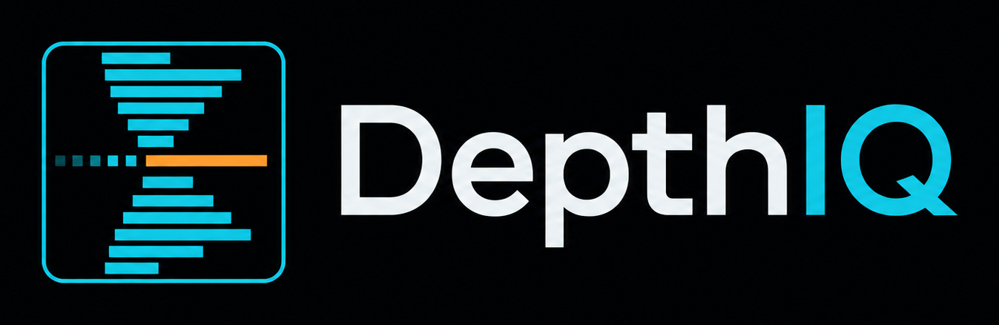

<p align="center"></p>

# BookDepthIQ-NT

<p align="center">
  <a href="https://buy.stripe.com/dRmaEW9AnfzT3gpf1senS0a"></a>
  <br><sub><b>Free to use.</b> If it helps your trading, leave a tip, any amount you like. Secure checkout by Stripe.</sub>
</p>

A modern standalone pop-out **DOM for NinjaTrader 8**, built with **Avalonia** (.NET 8). It is a full
port of the [BookDepthIQ-Vest](https://github.com/autopilotaitech/BookDepthIQ-Vest) panel, with the
same ladder, look, reads and click behaviour. Risk is worked out in **CME contracts, ticks and tick
value, with commissions**, and against **your prop firm's drawdown rules**.


```
┌──────────────── NinjaTrader 8 ────────────────┐                ┌──────── BookDepthIQ DOM (Avalonia) ────────┐
│ your connection (Rithmic / CQG / NT Brokerage)│                │ ladder · reads · tape · journal · order log │
│ BookDepthIQBridge AddOn: depth, prints,       │── 127.0.0.1 ──▶│ CME risk ticket · settings                  │
│   history, account, positions, orders, fills  │◀── commands ───│ every order = your click                    │
└───────────────────────────────────────────────┘                └─────────────────────────────────────────────┘
```

The DOM runs in its own process. If it crashes, NinjaTrader and your orders are not affected. The
bridge is a thin AddOn: it streams data and executes what the DOM sends. It never decides to trade.

> **Status: beta, test on Sim101 first.** The bridge compiles against NinjaTrader 8.1.x. The DOM has
> run against a simulated feed. Run it on Sim101 before any funded account.

## Install

**Current release: [1.12.13](https://github.com/autopilotaitech/BookDepthIQ-NT/releases/tag/v1.12.13).**
Download the [Windows x64 ZIP](https://github.com/autopilotaitech/BookDepthIQ-NT/releases/download/v1.12.13/BookDepthIQ-DOM-1.12.13-win-x64.zip).
**1.12.13 is DOM-only if upgrading from 1.12.10–1.12.12; the bridge is unchanged.**
Upgrading from 1.12.9 or earlier requires replacing BOTH DOM and bridge, then compiling with F5.
New entries are refused with an older bridge; emergency exits remain available. Keep beta on until
the [native SIM checklist](docs/TICKET-VERIFICATION-1.12.10.md) passes.

### New in 1.12.13 — hide the no-chase guide

The yellow NO CHASE line and label are **OFF by default**, including when loading older settings.
ST1/ST2 lines remain unchanged. An optional **Settings › Indicators › Chart lines › Show no-chase
level** switch can restore it (SuperTrend lines must also be enabled).

[Logic audit](docs/NO-CHASE-AUDIT-1.12.13.md): this is only a fixed ST1 ± 2 ATR visual distance guide,
not a validated prediction, order filter, stop or target. Hiding it does not change ADX, EXTENDED,
scalp calculations, entries, bracket handling or management. No user settings file is forcibly reset.
254 isolated automated tests pass (226 core/DOM + 28 bridge-source), including default hiding,
ST preservation, opt-in geometry, toggle behavior and old settings migration. No native orders sent.

### New in 1.12.12 — configurable ADX market state

Settings › Indicators › **ADX · MARKET STATE**:

- Timeframe **1 / 3 / 5 / 10 / 15 / 30 minutes**, default **3 minutes**.
- ADX period **1–100 bars**, default **14**; trend threshold **1–100**, default **25**.
- Existing market-state badge shows `CHOP · ADX 18.4` or `TREND ▲/▼ · ADX 28.6`.
  The tooltip identifies timeframe, period, threshold and DI values. No new toolbar row/panel.
- ADX measures strength, not direction or a prediction. +DI/−DI determine the arrow; SuperTrend's
  separate score is unchanged. EXTENDED retains its existing VWAP/ST distance calculation.
- Completed bars only; `ADX —` while history is loading, the feed is stale/disconnected, or fewer
  than `2 × period + 1` completed traded bars are available. Empty intervals are not invented.
- A separate bounded aggregate-bar cache leaves scalp/swing calculations unchanged. History requests
  expand to at least five periods plus headroom, capped by the existing bridge's **48-hour** limit,
  without overwriting your saved history preference. Default 30-minute/14-period requests **38h**.
  Weekends, provider gaps and large periods may still require additional live bars; no fake score.

The recurrence matches the installed NT8 `@ADX.cs` initialization and Wilder smoothing, including
its zero-DI fallback of 50 (no direction still classifies as CHOP).
[NinjaTrader documents ADX and its source](https://ninjatrader.com/support/helpGuides/nt8/average_directional_index_adx.htm).
Scores depend on identical OHLC bars, history seed, session boundaries and completed-bar timing;
an independently loaded NT chart can differ until inputs/seed match. This is not a direct native
indicator instance or a claim of live chart parity. Save settings to rebuild from history.

**Verification:** 248 isolated automated tests (220 core/DOM + 28 bridge-source), including numeric
fixtures, all six timeframes, period changes, closed-bar/caching behavior, persistence, settings
controls/cancel and actual badge updates/stale clearing. Settings visually checked with a headless
render. No actual SIM/LIVE orders sent; remains beta with native Ticket certification outstanding.

### New in 1.12.11 — Outlook cleanup

Removed the entire Watching / confirmed-hold status row and its extra spacing. BID/ASK pulling and
stacking now sit directly below the Outlook controls. Timeframes, collapse, STATE, data freshness,
observations and all trading behavior remain unchanged. 220 isolated automated tests pass, including
a headless Outlook layout/data/collapse regression. Still beta; native execution certification pending.

### New in 1.12.10 — reduction fills and cleaner order buttons (still beta)

- Removed the extra yellow BRACKET OFF warning above the buttons. The existing bracket toggle
  remains; saved settings are unchanged.
- Opposite-side ladder/market clicks against an existing position are treated as reductions:
  no new entry TP/SL or B/E/trailing watch is attached. Oversized reductions are refused.
- Owned TP/SL OCO pairs reconcile to actual remaining exposure after fills. Pending reductions
  also shrink when another exit fills first. CLOSE HALF leaves protection in place until its fill.
- Queued entry protection is discarded after flat rather than attached to a later reopened position.
  Unsubmitted protection waits for pending changes/cancellations; each submitted fragment has its
  own OCO pair. Monitoring survives account selection changes during queued submission.

**Verification:** 219 isolated automated tests (191 core/DOM + 28 actual-bridge-source tests),
including deferred dispatcher, quantity-change and cancellation acknowledgment cases. BridgeCheck
compiles against installed NinjaTrader DLLs. These are not native SIM orders or broker OCO certification.
`reduceOnly` is a bridge intent/check, **not exchange-enforced reduce-only**: competing native fills
can still race cancellation/change acknowledgments. This patch is not the larger proposed transactional
SCALE IN/OUT redesign. Remain on SIM until the native checklist passes.

### New in 1.12.9 — Ticket safety fixes (still beta)

- SCALE preserves enabled TP/SL protection, distributing the ticket's whole-contract target totals
  across child entries. Each filled slice keeps its original TP1/TP2/TP3 identity and OCO pair.
- REVERSE waits for acknowledgment, a fresh flat position and empty instrument orders before one
  opposite entry with the captured size and brackets. It aborts on timeout, cancellation, ticket edits,
  account/instrument changes or disconnect/reconnect. The captured stop is rechecked against current
  equity, fees and limits before sending; it cannot bypass risk checks using a newly smaller swing stop.
- Trailing and B/E honor OFF. Management is cleared on account/session changes. Pending limit
  entries keep their management watches, including flat gaps between SCALE fills.
- B/E after TP1 requires actual, deduplicated TP1 executions covering the first target's quantity;
  CLOSE HALF or cancelled targets cannot fake a TP1 fill.
- Entries wait for fresh balances, selected-instrument position and orders. Account changes clear old
  balances. Pending bridge entries retain bracket handling even if another account is selected.
- BRACKET OFF is explicitly labeled. The extra warning originally added in this version is removed
  in 1.12.10; your saved setting is not silently switched on.

**Proof:** 200 automated tests pass (189 core/DOM plus 11 tests of the actual bridge source against
an isolated test-only NinjaTrader API simulator and the real .NET Framework JSON parser). BridgeCheck
compiles against installed NinjaTrader assemblies with zero warnings/errors. No actual SIM or LIVE
orders were sent by these tests; native execution/OCO certification remains yours to perform.

### New in 1.12.8

Journal now has **RESET SIM**: select SIM and a specific account (not All accounts), then confirm.
This clears that account's recorded journal across **all dates and instruments**, refreshing the
calendar, analytics and recorded TODAY totals. NinjaTrader's SIM reset does not clear this app's
separate journal automatically. A recoverable `journal.json.before-*.bak` is saved beside the journal
in `%APPDATA%\BookDepthIQ-NT` before replacement; storage failures leave the in-memory history intact.
Other accounts and LIVE records are untouched. No orders are sent; balances, risk equity baselines,
drawdown limits and open trades are not reset. An open trade is still recorded when it closes.
119 automated tests pass, including confirmed/cancelled UI reset, backup, reload, account isolation,
LIVE rejection and storage failure. DOM only; bridge unchanged.

### New in 1.12.7

TODAY now shows recorded closed-trade P&L and completed round trips for the selected account's
CME session (17:00 Chicago rollover), after recorded fees. It no longer subtracts a saved equity
baseline or displays an independent saved trade counter. The journal calendar and date filters use
the same trading-date boundary. REALIZED remains the figure reported by NinjaTrader; it can cover
a different period or trades not recorded by this DOM. Risk equity baselines remain separate;
trade counts reconcile from recorded activity after a journal reset, and account snapshots must be
fresh before a new risk baseline is saved. DOM only; bridge unchanged.

### New in 1.12.6

A thin silver line runs through the HEAT column where the best bid / ask sat in each time slice, so the
bid side (below) and the offer side (above) are easy to tell apart now that ordinary levels fade. It steps
with the market; its colour is **Settings › Colours › Heat bid/ask line**. DOM only; bridge unchanged.

### New in 1.12.5

The HEAT column fades ordinary liquidity so real size stands out. Brightness is measured from the
typical (median) resting size on screen: levels at or below it draw as a faint trace, and brightness
climbs a curve up to the 98th percentile, so only large resting orders glow. Yellow marks a wall:
at least 3× the typical size. **Settings › Ladder › Heat contrast** (Soft / Normal / Sharp) sets how
hard ordinary levels fade; Normal is the default. Only the DOM changes; the bridge is the same as
1.12.4 (no F5 needed).

### New in 1.12.4

FLOW cells now have a directional heatmap behind readable signed numbers. Cyan indicates bullish
pressure (bid stacking or ask pulling); orange indicates bearish pressure (ask stacking or bid pulling).
Bar width and brightness reflect directional net flow relative to total adding/removing activity.
Numbers retain their raw meaning: positive = net stacking, negative = net pulling. Direction uses
the bid/ask side when the flow occurred and aggregates across grouped ladder rows.

### Included since 1.10.6

- Live/prop account discovery refreshes automatically; the top selector shows connection status and a refresh button.
- TAPE has its own toolbar button; JOURNAL opens a separate calendar and analytics window.
- The collapsible OUTLOOK panel uses the existing theme; FLOW and ABS are separate ladder columns.
- FLOW has independent 5/15/60-second windows. Unknown-side prints no longer bias SuperTrend delta.
- Indexed absorption and cached row reads reduce repeated render work; bridge messages use bounded, ordered batches.
- Journal accounting isolates accounts and corrects scale-in-after-partial-exit calculations for new trades.
- 89 automated tests, including simulated execution, persistence, account discovery and rendered UI tests.

Existing journal rows are retained as recorded; installing this release does not repair previously
miscalculated historical trades. Journal totals cover recorded round trips, not imported broker history.

**Download** the latest `BookDepthIQ-DOM-x.y.z-win-x64.zip` from
[Releases](https://github.com/autopilotaitech/BookDepthIQ-NT/releases) and unzip it.

1. **Bridge (once, and after each update):** copy `NinjaTrader\BookDepthIQBridge.cs` to
   `Documents\NinjaTrader 8\bin\Custom\AddOns\`. In NinjaTrader open **New → NinjaScript Editor**
   and press **F5**. It listens on `127.0.0.1:36971` only (this PC).
2. **DOM:** run `BookDepthIQ-DOM.exe`. It is self-contained, so nothing else needs installing.
   Windows may say "Windows protected your PC" because the exe is not code-signed: **More info →
   Run anyway**. The header shows **● NT** when it is connected, with the median time NinjaTrader
   takes to answer.
3. Type the instrument (for example `NQ 12-26`) and press **Go**, then pick **Sim101**. The DOM
   loads up to 48 h of NinjaTrader tick history so SuperTrend, VWAP, the opening range and the
   profile are right from the start.

**From source:** `dotnet run --project src/Dom` (needs the [.NET 8 SDK](https://dotnet.microsoft.com)).

## Layout

The ladder runs the full height on the left. The right column holds, from top to bottom:

- **TAPE**, with **JOURNAL** and **LOG** chips that swap the view (click again for the tape), plus
  **TICKET**, **HEAT** and **ST** toggles (lit = on). Text size: **SETTINGS → Tape & log**, or
  **Ctrl+wheel** over the tape or log.
- **TICKET** (hide it with the **TICKET** chip; hidden = tape and buttons only):
  a **READOUT** of contracts · risk · win · R:R · % of room · losers left in big type, with the cost,
  warning and result lines. Under it are cards with segmented controls and pill toggles: **SIZE**,
  **STOP** (ticks / ATR / swing + BRACKET), **TARGETS** (TP1–3 + split), **MANAGE** (B/E after TP1,
  stop guard, trail), and **ENTRY** (setup, hotkeys, preview, scale).
- **Buttons** in three columns: **BUY MKT · SELL MKT · FLATTEN**, then **REVERSE · CANCEL ALL**,
  then **B/E · CLOSE HALF**.

## The ladder

**Resize anything:** drag a divider in the ladder's header row (the cursor turns ↔) to make any
column any width. Double-click a divider to reset every column. Drag the bar between the ladder and
the right column to size the right column. All of it is saved.

Columns (each can be turned off in **SETTINGS → Ladder**): **HEAT · PULL/STACK | BUY | SOLD |
BID | PRICE | ASK | BOUGHT | SELL | P&L | PROFILE | Δ**. The heatmap sits at the far left, next to
BUY.

- **Click** the buy side (BUY, SOLD, BID) for a buy limit, the sell side (ASK, BOUGHT, SELL) for a
  sell limit. **Shift-click** places a stop. **Double-click** a row that already has an order to **add** another
  one there. **Right-click** a working order to cancel it (every order on that side at that price);
  **drag** it to move it (all of them). Several orders at one price show as one chip, e.g. `LMT 3 ×2`.
- **Price:** best bid and ask are coloured, the yellow box is the last price, and the dashed amber row
  is your average. The yellow bar marks the POC; the shaded rows are the value area.
- **BID/ASK:** depth bars. A **wall** (3× the average size on that side) shows yellow.
- **SOLD/BOUGHT:** volumetric footprint. Each cell is a bar sized by its volume (scaled to the busiest
  cell on screen) growing out from the price column, with the number on top. Diagonal **imbalances**
  are solid bars with an edge on the price side; stacked ones get a white edge and are drawn as
  **BUY/SELL STACK** lines. BID/ASK size bars also scale to the rows on screen.
- **HEAT:** resting size over the heat window (5 minutes by default, in 10-second bins), time-averaged and coloured
  by the side it was on. Yellow means a wall. **PULL/STACK** shows the net size pulled or added in
  the last minute at every eligible visible level; lower-confidence re-quoting flow is muted. **ABS** means absorption: one side kept hitting a level for more than was showing,
  and it held.
- **Heat window:** SETTINGS → Ladder → 5 / 15 / 30 / 60 min. That's 30 slices across the window, with
  pull/stack and absorb over a fifth of it (1 min at 5 min, as before).
- **nPOC (naked POC):** each period (5 / 15 / 30 / 60 min, SETTINGS → Ladder) gets its own volume POC,
  like the POC of one footprint bar. When the period closes it is drawn as a pink dashed **nPOC HH:MM**
  line, but **only while it is naked**. Once price trades back at it, the auction there is finished
  and the line is gone. Built from history plus live, so earlier periods' nPOCs show at once.
- **PROFILE / Δ:** drawn as BookDepthIQ's ladder draws them. The profile is a neutral grey volume
  histogram (POC near-white, value area mid-grey, outside it dim grey), with the value area as a
  faint magenta band on PRICE. Δ is a signed bar from the column centre, cyan for + and orange for −.
  **Visible range:** the POC, value area and bar scale come from the rows on screen, so they follow
  scrolling and zoom. Δ scales to the visible rows too. Both update on every print.
  **Start time (SETTINGS → Indicators):** profile, Δ and the footprint count **live** prints from
  your start time (HH:MM in the VWAP zone), or from when the DOM opens if it is blank (the default).
  **Use history** backfills from the start time with NinjaTrader's history; otherwise it is live
  only. SuperTrend, VWAP, the opening range and the heatmap always use history, so they are ready at
  once.
- **P&L:** what each price is worth to your open position.
- **Lines:** VWAP with ±σ bands, ST1/ST2, nPOCs, GEX levels, the RTH opening range (NQ/ES,
  BookDepthIQ PAXOR, coloured as in the Vest panel: OR H blue, OR L red, MID gold, EXT rungs dashed),
  **NO CHASE** (ST1 ± 2 ATR), RANGE H/L in chop, your TP/SL legs with their $, **FAIL** (where the
  account fails at this size) and the preview. Lines pass **behind** every number. Lines off the
  screen are pinned at the right (Δ column), top or bottom, with their distance.
- **Zoom on the PRICE column:** wheel over PRICE (or drag it up/down) zooms in and out. Row height
  first, then ticks per row (1 → 2 → 4 → 8 → 20 → 40 → 100). The price under the mouse stays put.
  **Double-click PRICE** (or **Home**) goes back to 1 tick per row, centred. **+/−** zoom around the
  middle; a badge shows the scale.
- **Wheel elsewhere** scrolls (Shift = a page) and holds the view for 15 s. **Space** re-centres.
  Otherwise the ladder holds still unless price drifts.

## Header reads

- **SuperTrend:** dual ST, a port of BookDepthIQ's `trend.rs`, for example **▲▲ STRONG LONG +75**.
- **Scalp read:** **GO — pullback to ST1** (within 2 ATR of the line and pulling back), **wait for
  the dip**, or **STRETCHED — don't chase**.
- **Market state:** **TREND / CHOP + ADX score**, from the selected completed-bar timeframe and
  ADX period/threshold in Settings › Indicators. DI supplies direction, not ADX. **EXTENDED** still
  describes distance from VWAP/ST; no forecast or automatic entry.
- **FEED:** milliseconds since NinjaTrader's last book or print.

## Ticket and risk (CME)

- **Size:** **contracts**, **$ risk @SL** or **% room @SL**, with quick buttons. Contracts are whole;
  a $ risk too small for one contract says so.
- **Stop:** **ticks**, **ST1 ATR × mult** or **swing** (past the N-minute high/low). **TP1–TP3** are in
  ticks, or in R in ATR/swing mode, with a **split** such as 50/30/20.
- **Brackets, like NT's ATM:** each fill is split across your targets. Each slice gets its own TP and
  SL as one OCO pair, so a partial fill is protected at once.
- **Risk line:** contracts, SL, $/tick, risk and win with fees, R:R, % of room, losers left and
  break-even ticks. It turns red when the stop is past the fail line.
- **Warnings** (size × your normal, far from the market, spread wide, stop past the fail line, over
  your max contracts) never block. One click sends.
- **Cost line:** spread gate against this market's own recent spreads, your fill for this size,
  slippage, all-in break-even, and TP as a multiple of cost.
- **PREVIEW LONG/SHORT:** the stop and targets drawn on the ladder while flat. Drag them to set the
  distances.
- **SCALE:** a ladder click sends 2–10 limits from that price away from the market.
- **Buttons:** **BUY MKT**, **SELL MKT**, **B/E**, **CLOSE HALF** (bracket legs trimmed),
  **REVERSE**, **CANCEL ALL** (Esc), **FLATTEN** (F), **KILL** (Ctrl+K: every position and order on
  the account). Exits are never blocked.
- **Hotkeys** B / S / E / R work only while **HOTKEYS ARMED** is on. On SAFE they say so.

## Account rules and protect my day

- **SETTINGS → Account:** start balance, max drawdown, **static / trailing intraday / trailing
  EOD**, where trailing stops (lock), and the prop daily loss. Room = equity − floor, or today's
  limit if that is tighter. A bar shows the room left.
- **SETTINGS → Protect my day** (all off by default): daily loss limit, max trades, cooldown after a
  loss, close everything at the limit, and close before the Friday CME halt. Limits apply to NEW
  entries only. The day starts 17:00 Chicago.
- **Management that acts without a click** (each off until you turn it on, and none ever opens a
  position): **B/E after TP1**, **trailing stop** (after N R, or on ST1/ST2), **stop guard** (puts a
  vanished stop back), and the two closes above.

## GEX levels

This is a port of BookDepthIQ's GEX Levels. It computes dealer gamma from **CBOE's free delayed option
chains**:

| Futures | Option chain | Converted by |
|---|---|---|
| ES / MES | SPX | spread |
| NQ / MNQ | QQQ | ratio |
| YM | DIA | ratio |
| GC | GLD | ratio |
| CL | USO | ratio |

The ladder draws these lines:
- **CALL WALL** and **PUT WALL**
- **γ FLIP** (the zero-gamma spot)
- **MAGNET**
- **GEX 1…n**
- **RANGE HIGH / LOW** (the one-day move from iv30)

The **GEX** read in MARKET shows +γ (dealers damp moves) or −γ (they amplify them), with the net $
per 1% move. Hover it for every level.

- **How the levels hold:** they change only when the daily open-interest vintage changes, and the
  futures conversion is frozen with them, so the lines don't wander with price. RECALC in settings
  shows the map recomputed every poll instead.
- **No measured conversion = no lines:** the spread or ratio is the median of 30+ s of live book
  mids. Replayed prints never feed it.
- **Fetching:** polls every 60 s on its own task, with gzip and If-None-Match (a 304 costs no bytes).
  It never touches an order.
- **Settings › GEX:** on/off, expiries (4 nearest / 0DTE / all), daily or recalculated map, how many
  numbered levels, range, magnet, line width. Colours are in Colours › GEX.
- **Caveats:** dealer positioning is inferred (customers sell calls, buy puts), not observed. The
  data is delayed. These are levels, not direction.

## Initial Balance

Ported from BookDepthIQ's IB layer (v1.0.146/147). **Off by default:** SETTINGS → Initial balance.

- The IB is the high and low of the first **1, 3, 5, 15, 30 or 60 minutes** after the open, from every
  trade in the half-open window `[open, open + length)`. **RTH** opens at the OR bell for index futures
  (08:30 Chicago; CL 08:00, metals and treasuries 07:20); **Globex** at 17:00 Chicago (Sunday–Thursday).
  All 12 ranges are tracked at once, so switching session or length is instant.
- **Lines:** IB H (cyan) and IB L (orange), dashed while the window is open; MID; the 1.5×, 2× and 3×
  extensions once it forms; optionally the IB window's value area (VAH / VAL).
- **IB pill** in the header: building `3/15`, inside, `▲ 09:12 Δ +340` (broke high at 09:12, delta since
  the break), `▼` (broke low), back inside. Its tooltip has H / L / MID / range, POC and value area,
  range vs the median of past days, percentile (from 5 days), the previous IB and the latest events.
- Built from NinjaTrader's tick history and then live prints. If the DOM opens after an IB closed and
  the history doesn't reach back to the open, it shows **missed** unless an earlier run recorded it;
  raise SETTINGS → Ladder → History to load. A DOM that joins mid-window marks the IB **PARTIAL**.
- Every whole IB that forms is saved to `%APPDATA%\BookDepthIQ-NT\ib-history.jsonl` (one row per day,
  instrument, session, length and open time) for the stats. The Playback connection never writes.

## Package to share

The top account selector lists all accounts NinjaTrader exposes, including prop accounts, with
connection status. Account-list changes refresh automatically within two seconds; the adjacent
↻ button requests a fresh list immediately. Selecting an account remains a manual action.
Install and compile the updated bridge for automatic discovery.

The DOM indexes recent trades for absorption and caches row reads until the next
trade/book/window change. Bridge delivery uses ordered, bounded batches (2,048 pending messages)
with short UI time slices; it preserves every event and applies backpressure rather than dropping
prints or fills. Tape flash-cache cleanup uses a retained-trade set once per second.

### Professional journal

The JOURNAL toolbar button opens a dedicated Calendar / Analytics window, styled with the DOM's
existing theme. Filter by SIM / LIVE / PLAYBACK, account, instrument and date range. The calendar
shows daily net P&L and opens that day's trade timeline. Analytics includes cumulative P&L,
drawdown, win/loss and long/short splits, profit factor, expectancy, fees, streaks and breakdowns.
Review notes and setup tags are saved with each trade; EXPORT CSV copies the filtered history.
Prices and P&L come from recorded NinjaTrader executions, with commissions/fees included.
The journal records executions while the DOM is connected; it does not import earlier broker history
or recover a position opened before recording began. A completed round trip is counted as one trade.
SIM/LIVE/PLAYBACK classification uses the account name (Sim / Playback prefixes); environments are
filtered separately. This release requires the included updated AddOn to be copied and compiled.

The OUTLOOK toolbar button shows a collapsible evidence panel above the tape. It reports
bid/ask replenishment, absorption holds, ST disagreement and regime. FLOW has independent
5/15/60-second windows; ABS has its own ladder column (B = bid, A = ask).
Observed holds are recorded to `%APPDATA%\BookDepthIQ-NT\outlook-observations.jsonl`.
No calibrated probability is displayed yet; these observations are not trade returns.

```
powershell -ExecutionPolicy Bypass -File tools\package.ps1 -Version 1.12.13
```

This runs both test suites, then builds `dist\BookDepthIQ-DOM-1.12.13-win-x64.zip` (~37 MB), which holds:
- `BookDepthIQ-DOM.exe`: one self-contained file, so the user needs no .NET install.
- `NinjaTrader\BookDepthIQBridge.cs`: the AddOn.
- `INSTALL.txt`: the install steps.
- `LICENSE.txt` and `DISCLAIMER.txt`.

The exe is not code-signed, so Windows SmartScreen asks once ("More info › Run anyway").

## Settings and colours

SETTINGS has a section rail on the left: Account, Fees & warnings, Protect my day, Ladder, Tape &
log, Indicators (one set for every instrument), GEX, SuperTrend, Opening range, Initial balance, Colours. Each section is a set of cards with ON/OFF switches
and segmented choices. **SAVE** (Ctrl+S) applies everything; **CANCEL** (Esc) discards.

- **SETTINGS → Colours:** every colour the DOM draws can be changed:
  - surfaces, text and accent
  - bid/ask and profit/loss
  - chart lines (VWAP, nPOC, opening range, SuperTrend, no-chase, stacks) and GEX
  - profile, Δ and heat
  - order buttons
  - tape and log
- Pick a swatch or type `#rrggbb`. **↺** resets one colour. Presets: Default, Midnight, Graphite and
  High contrast.
- Colours change live while you pick. CANCEL puts them back.

## Journal and order log

- **Journal:** every round trip, built from NinjaTrader's executions. Entry, exit, size, $ after
  commissions and fees, R, setup tag and slippage against the price you clicked. Totals by setup.
  **copy CSV**.
- **Order log:** every click, what was sent, NinjaTrader's answer with its time, rejections with
  NT's reason, warnings and blocks. **copy** it for a bug report.
- **Replay:** use NinjaTrader's own **Playback** connection. The DOM shows it like any other feed,
  on the Playback101 account.

## Develop

```
dotnet build                                   # Core, DOM, tests, fake bridge
dotnet test                                    # 254 tests, including isolated Ticket/bridge regression cases; no broker orders
BDIQ_PORT=36972 dotnet run --project tools/FakeBridge -- --position   # simulated NQ, never sends orders
BDIQ_PORT=36972 dotnet run --project src/Dom   # the DOM against the fake (NinjaTrader is not touched)
dotnet build nt8/BridgeCheck                   # compiles the AddOn against C:\Program Files\NinjaTrader 8\bin
```

The protocol is in [docs/PROTOCOL.md](docs/PROTOCOL.md) and the port plan in
[docs/PORT-PLAN.md](docs/PORT-PLAN.md). Rules for changes are in [CLAUDE.md](CLAUDE.md).

## License and disclaimer

[MIT](LICENSE) © 2026 autopilotaitech.

**Trading futures involves substantial risk of loss.** This is a tool, not financial advice, and it
comes with no warranty. Test on Sim101 first. NinjaTrader is a trademark of NinjaTrader, LLC; this
project is not affiliated with it. GEX uses Cboe's delayed quotes, which each copy fetches itself
under Cboe's terms. Full text: [DISCLAIMER.md](DISCLAIMER.md).
