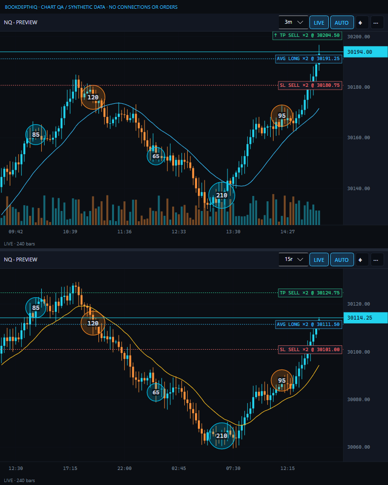

# BookDepthIQ-NT changelog

Release notes as they appeared in the README, newest first. Each release's own notes are on
[GitHub Releases](https://github.com/autopilotaitech/BookDepthIQ-NT/releases).

## New in beta.14 — cumulative beta.8–14 updates

- Tokyo/London/New York session zones with custom hours, named time zones, colors and per-chart visibility.
- More readable large-trade circles and exact quantity badges, preserving thresholds and custom colors.
- Manual stop-first/TP-first exit coverage correction; separately clicked exits are bridge-managed,
  **not broker-native OCO**. See [execution limitations](https://github.com/autopilotaitech/BookDepthIQ-NT/blob/v1.13.0-beta.14/docs/MANUAL-EXIT-COVERAGE.md).
- Only tinted BUY/SELL ladder columns submit new orders. Scroll/drag cancels pending entry;
  existing order management remains. Optional help: Ticket → ENTRY → COLUMN HELP.
- Corrected PAX extension activation, same-day plot end, zero prior-day history and current/prior-day styling.
- Live chart event-series and rollover fixes prevent completed bars remaining marked forming and freezing PAX growth.
- **416 isolated tests pass** (370 Core/DOM +46 Bridge); Release/native builds clean. No native orders
  sent during agent verification; provider execution, atomic cancellation and HFT latency are not certified.

## Main branch updates — 1.13.0-beta.10

Beta.10 corrects chart PAX extension activation and same-day plot endpoints against the supplied
PAX source. Previous sessions can be **0 (today only)**; zero step hides extensions without hiding
OR H/L. Today has dated TODAY labels; prior dates are dimmed. [Audit and proof](PAX-CHART-CORRECTION.md).

**Beta.9 correction: replace `BookDepthIQChartBridge.cs` and recompile in NinjaTrader as well
as updating the app.** Live bar callbacks now read the event's bar series rather than the history
snapshot, fixing dropped updates on the candle and shared session source. The app flags old or
implausibly future candle timestamps instead of treating history completion as proof of LIVE data.
See [fix evidence and upgrade steps](CHART-LIVE-UPDATE-FIX.md).

*Synthetic chart-control fixture, not a live trading screenshot. The main DOM layout is unchanged.*

- Optional Tokyo, London and New York high/low range boxes, initially **OFF**. Open the
  chart's **… → settings → SESSION ZONES** to enable them globally and on either chart.
- Independent session toggles, colors, editable start/end hours and named time zones;
  adjustable shading, labels, completed-session history and high/low extensions.
- Native 30-second source shared with PAX; exact integer-tick highs/lows, DST-aware windows,
  and explicit PARTIAL/STALE coverage. Day charts omit intraday session zones.
- Subtle fills behind candles; labels remain at their true price or are omitted when crowded.
  Zoom/pan/recenter and order/current-price overlays remain available. No chart trading actions.
- **385 automated tests pass** (351 core/DOM +34 bridge-source), including stale-history,
  reload/disconnect guards, extension-only views and dense-label checks at three DPI scales.
  Release/native compilation passes. Native/provider parity and extended soak testing remain pending.

[Verification, benchmark and remaining limitations](SESSION-ZONES-VERIFICATION.md).

## New in 1.13.0-beta.7 — trade bubbles, chart orders and navigation

- Optional live executed-trade bubbles, with per-instrument thresholds, buy/sell/unknown colors,
  opacity, size and quantity labels. Settings → Chart settings → LARGE TRADES; OFF by default.
- Individual reported prints only, not reconstructed parent orders or institutional identification.
  Live capture is bounded; historical bubbles are not yet included. Daily/unproved session intervals
  are omitted; dense views retain larger prints without merging quantities.
- Display-only working entry/TP/SL and position-average lines on both charts, filtered by account
  and contract. No chart interaction submits, modifies or cancels orders.
- Tick-accurate live-price tags, crosshair price/time/OHLCV and optional linked cursors. CENTER/Space
  recenters while preserving time zoom; improved manual scaling, panning and explicit history reload.
- Fixes contract switches retaining unrelated manual price scales and right-edge zoom hiding candles.
- **356 isolated tests pass** (322 core/DOM +34 bridge-source). Release/native compile checks and
  synthetic desktop rendering pass. Native/provider acceptance and HFT latency are not certified.

[Bubble controls, verification and limitations](LARGE-TRADES-VERIFICATION.md) ·
[Chart navigation evidence](CHART-NAVIGATION-VERIFICATION.md).

## New in 1.13.0-beta.3 — two charts and compact DOM telemetry

- Optional two stacked native candle charts LEFT; existing DOM RIGHT. Initial 32%/68% proportions;
  drag the vertical/horizontal dividers to resize, collapse charts or maximize one within their column.
- Independent 1m/3m/5m/15m/30m/1h/4h/Day frames, default 3m and 15m, linked to the DOM contract.
- Pointer-centered time zoom, pan, independent LIVE/Follow and AUTO price scale. Per-chart lookback
  settings of 250–10,000 bars; optional volume, SMA/EMA and PAX-style opening range.
- PAX is OFF initially and disabled on 1h/4h/Day. This is not an arbitrary NinjaScript indicator loader.
- Compact two-row telemetry retains the readouts and fonts while recovering ladder height. Individual
  readouts wrap at narrower widths, instead of whole large groups occupying tall separate rows.
- Separate read-only chart connection on localhost:36974. DOM/orders stay on 36971; Bubbles stays on 36972.
  Chart handshake validation prevents connecting to the wrong bridge and hanging on Loading.

**289 isolated automated tests pass** (256 core/DOM + 33 bridge-source); Release packaging and native
net48/C#6 compile pass. Owner reports chart loading and compact layout working. No agent-submitted
native orders; full native SIM/parity/provider/latency acceptance is not claimed.
[Chart controls and remaining limitations](CHART-WORKSPACE.md).

## New in 1.12.13 — hide the no-chase guide

The yellow NO CHASE line and label are **OFF by default**, including when loading older settings.
ST1/ST2 lines remain unchanged. An optional **Settings › Indicators › Chart lines › Show no-chase
level** switch can restore it (SuperTrend lines must also be enabled).

[Logic audit](NO-CHASE-AUDIT-1.12.13.md): this is only a fixed ST1 ± 2 ATR visual distance guide,
not a validated prediction, order filter, stop or target. Hiding it does not change ADX, EXTENDED,
scalp calculations, entries, bracket handling or management. No user settings file is forcibly reset.
254 isolated automated tests pass (226 core/DOM + 28 bridge-source), including default hiding,
ST preservation, opt-in geometry, toggle behavior and old settings migration. No native orders sent.

## New in 1.12.12 — configurable ADX market state

Settings › Indicators › **ADX · MARKET STATE**:

- Timeframe **1 / 3 / 5 / 10 / 15 / 30 minutes**, default **3 minutes**.
- ADX period **1–100 bars**, default **14**; trend threshold **1–100**, default **25**.
- Existing market-state badge shows `CHOP · ADX 18.4` or `TREND ▲/▼ · ADX 28.6`.
  The tooltip identifies timeframe, period, threshold and DI values. No new toolbar row/panel.
- ADX measures strength, not direction or a prediction. +DI/−DI determine the arrow; SuperTrend's
  separate score is unchanged. EXTENDED retains its existing VWAP/ST distance calculation.
- Completed bars only; `ADX —` while history is loading, the feed is stale/disconnected, or fewer
  than `2 × period + 1` completed traded bars are available. Empty intervals are not invented.
- A separate bounded aggregate-bar cache leaves scalp/swing calculations unchanged. History requests
  expand to at least five periods plus headroom, capped by the existing bridge's **48-hour** limit,
  without overwriting your saved history preference. Default 30-minute/14-period requests **38h**.
  Weekends, provider gaps and large periods may still require additional live bars; no fake score.

The recurrence matches the installed NT8 `@ADX.cs` initialization and Wilder smoothing, including
its zero-DI fallback of 50 (no direction still classifies as CHOP).
[NinjaTrader documents ADX and its source](https://ninjatrader.com/support/helpGuides/nt8/average_directional_index_adx.htm).
Scores depend on identical OHLC bars, history seed, session boundaries and completed-bar timing;
an independently loaded NT chart can differ until inputs/seed match. This is not a direct native
indicator instance or a claim of live chart parity. Save settings to rebuild from history.

**Verification:** 248 isolated automated tests (220 core/DOM + 28 bridge-source), including numeric
fixtures, all six timeframes, period changes, closed-bar/caching behavior, persistence, settings
controls/cancel and actual badge updates/stale clearing. Settings visually checked with a headless
render. No actual SIM/LIVE orders sent; remains beta with native Ticket certification outstanding.

## New in 1.12.11 — Outlook cleanup

Removed the entire Watching / confirmed-hold status row and its extra spacing. BID/ASK pulling and
stacking now sit directly below the Outlook controls. Timeframes, collapse, STATE, data freshness,
observations and all trading behavior remain unchanged. 220 isolated automated tests pass, including
a headless Outlook layout/data/collapse regression. Still beta; native execution certification pending.

## New in 1.12.10 — reduction fills and cleaner order buttons (still beta)

- Removed the extra yellow BRACKET OFF warning above the buttons. The existing bracket toggle
  remains; saved settings are unchanged.
- Opposite-side ladder/market clicks against an existing position are treated as reductions:
  no new entry TP/SL or B/E/trailing watch is attached. Oversized reductions are refused.
- Owned TP/SL OCO pairs reconcile to actual remaining exposure after fills. Pending reductions
  also shrink when another exit fills first. CLOSE HALF leaves protection in place until its fill.
- Queued entry protection is discarded after flat rather than attached to a later reopened position.
  Unsubmitted protection waits for pending changes/cancellations; each submitted fragment has its
  own OCO pair. Monitoring survives account selection changes during queued submission.

**Verification:** 219 isolated automated tests (191 core/DOM + 28 actual-bridge-source tests),
including deferred dispatcher, quantity-change and cancellation acknowledgment cases. BridgeCheck
compiles against installed NinjaTrader DLLs. These are not native SIM orders or broker OCO certification.
`reduceOnly` is a bridge intent/check, **not exchange-enforced reduce-only**: competing native fills
can still race cancellation/change acknowledgments. This patch is not the larger proposed transactional
SCALE IN/OUT redesign. Remain on SIM until the native checklist passes.

## New in 1.12.9 — Ticket safety fixes (still beta)

- SCALE preserves enabled TP/SL protection, distributing the ticket's whole-contract target totals
  across child entries. Each filled slice keeps its original TP1/TP2/TP3 identity and OCO pair.
- REVERSE waits for acknowledgment, a fresh flat position and empty instrument orders before one
  opposite entry with the captured size and brackets. It aborts on timeout, cancellation, ticket edits,
  account/instrument changes or disconnect/reconnect. The captured stop is rechecked against current
  equity, fees and limits before sending; it cannot bypass risk checks using a newly smaller swing stop.
- Trailing and B/E honor OFF. Management is cleared on account/session changes. Pending limit
  entries keep their management watches, including flat gaps between SCALE fills.
- B/E after TP1 requires actual, deduplicated TP1 executions covering the first target's quantity;
  CLOSE HALF or cancelled targets cannot fake a TP1 fill.
- Entries wait for fresh balances, selected-instrument position and orders. Account changes clear old
  balances. Pending bridge entries retain bracket handling even if another account is selected.
- BRACKET OFF is explicitly labeled. The extra warning originally added in this version is removed
  in 1.12.10; your saved setting is not silently switched on.

**Proof:** 200 automated tests pass (189 core/DOM plus 11 tests of the actual bridge source against
an isolated test-only NinjaTrader API simulator and the real .NET Framework JSON parser). BridgeCheck
compiles against installed NinjaTrader assemblies with zero warnings/errors. No actual SIM or LIVE
orders were sent by these tests; native execution/OCO certification remains yours to perform.

## New in 1.12.8

Journal now has **RESET SIM**: select SIM and a specific account (not All accounts), then confirm.
This clears that account's recorded journal across **all dates and instruments**, refreshing the
calendar, analytics and recorded TODAY totals. NinjaTrader's SIM reset does not clear this app's
separate journal automatically. A recoverable `journal.json.before-*.bak` is saved beside the journal
in `%APPDATA%\BookDepthIQ-NT` before replacement; storage failures leave the in-memory history intact.
Other accounts and LIVE records are untouched. No orders are sent; balances, risk equity baselines,
drawdown limits and open trades are not reset. An open trade is still recorded when it closes.
119 automated tests pass, including confirmed/cancelled UI reset, backup, reload, account isolation,
LIVE rejection and storage failure. DOM only; bridge unchanged.

## New in 1.12.7

TODAY now shows recorded closed-trade P&L and completed round trips for the selected account's
CME session (17:00 Chicago rollover), after recorded fees. It no longer subtracts a saved equity
baseline or displays an independent saved trade counter. The journal calendar and date filters use
the same trading-date boundary. REALIZED remains the figure reported by NinjaTrader; it can cover
a different period or trades not recorded by this DOM. Risk equity baselines remain separate;
trade counts reconcile from recorded activity after a journal reset, and account snapshots must be
fresh before a new risk baseline is saved. DOM only; bridge unchanged.

## New in 1.12.6

A thin silver line runs through the HEAT column where the best bid / ask sat in each time slice, so the
bid side (below) and the offer side (above) are easy to tell apart now that ordinary levels fade. It steps
with the market; its colour is **Settings › Colours › Heat bid/ask line**. DOM only; bridge unchanged.

## New in 1.12.5

The HEAT column fades ordinary liquidity so real size stands out. Brightness is measured from the
typical (median) resting size on screen: levels at or below it draw as a faint trace, and brightness
climbs a curve up to the 98th percentile, so only large resting orders glow. Yellow marks a wall:
at least 3× the typical size. **Settings › Ladder › Heat contrast** (Soft / Normal / Sharp) sets how
hard ordinary levels fade; Normal is the default. Only the DOM changes; the bridge is the same as
1.12.4 (no F5 needed).

## New in 1.12.4

FLOW cells now have a directional heatmap behind readable signed numbers. Cyan indicates bullish
pressure (bid stacking or ask pulling); orange indicates bearish pressure (ask stacking or bid pulling).
Bar width and brightness reflect directional net flow relative to total adding/removing activity.
Numbers retain their raw meaning: positive = net stacking, negative = net pulling. Direction uses
the bid/ask side when the flow occurred and aggregates across grouped ladder rows.

## Included since 1.10.6

- Live/prop account discovery refreshes automatically; the top selector shows connection status and a refresh button.
- TAPE has its own toolbar button; JOURNAL opens a separate calendar and analytics window.
- The collapsible OUTLOOK panel uses the existing theme; FLOW and ABS are separate ladder columns.
- FLOW has independent 5/15/60-second windows. Unknown-side prints no longer bias SuperTrend delta.
- Indexed absorption and cached row reads reduce repeated render work; bridge messages use bounded, ordered batches.
- Journal accounting isolates accounts and corrects scale-in-after-partial-exit calculations for new trades.
- 89 automated tests, including simulated execution, persistence, account discovery and rendered UI tests.

Existing journal rows are retained as recorded; installing this release does not repair previously
miscalculated historical trades. Journal totals cover recorded round trips, not imported broker history.
