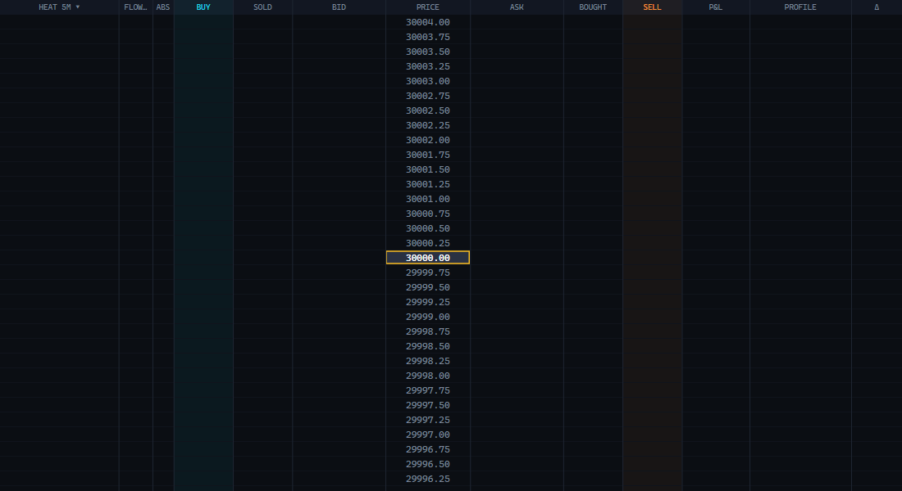

# Explicit ladder order columns — beta.13

Approved behavior: preserve single-click limit/Shift-stop ordering and existing order management,
but make BUY/SELL the only ladder entry columns. No new confirmation dialog or second-click gate.
Market buttons, Ticket sizing/brackets/scaling and armed hotkeys remain unchanged.

Changes:

- BUY has subtle cyan shading/header; SELL has orange shading/header. Data columns no longer
  show entry hover highlighting. SOLD/BID/ASK/BOUGHT/HEAT/FLOW/ABS/PRICE/P&L/PROFILE/DELTA never
  submit new orders. Hiding BUY/SELL disables new ladder entry instead of falling back to BID/ASK.
- One left-click submits on release at the original row/column. Movement beyond4DIP, crossing
  rows/columns, leaving the control, capture loss or wheel scrolling cancels pending entry.
  Middle/right buttons cannot submit new entries; middle/right button chords cancel pending entry.
- Existing order dragging and right-click cancellation remain; double-click adds only within
  BUY/SELL. Scrolling cancels an in-progress order drag rather than sending an unintended move.
- Short delayed hover descriptions explain columns. Ticket → ENTRY → COLUMN HELP turns these
  off immediately and saves the preference. Help is enabled initially; it never changes trading rules.

## Evidence

Three initial actual-pointer regression cases failed before implementation: unrestricted placement,
scroll/drag submission and absent help. A button-chord regression also failed before correction.
Actual Avalonia pointer tests cover every visible column, release-only submission, side/Shift-stop
preservation, middle-click, wheel, movement, hidden order columns, native-order drag/right-cancel,
hover without orders, saved help toggle/JSON and pixel-distinct column shading.

Full suite:413passed (369 Core/DOM +44 Bridge), zero failures/skips. Release and native bridge builds
clean. Rendered control inspected using an empty synthetic data fixture; no native connections,
orders or account changes. This does not claim a live SIM execution test or replace owner acceptance.

Upgrade: run beta.13 app. Bridge unchanged from beta.12; update/recompile the beta.12+ DOM bridge
if still using an earlier version (required order capability3). Includes beta.11 markers and beta.12
manual-exit coverage correction and its documented non-atomic/manual OCO limitations.
