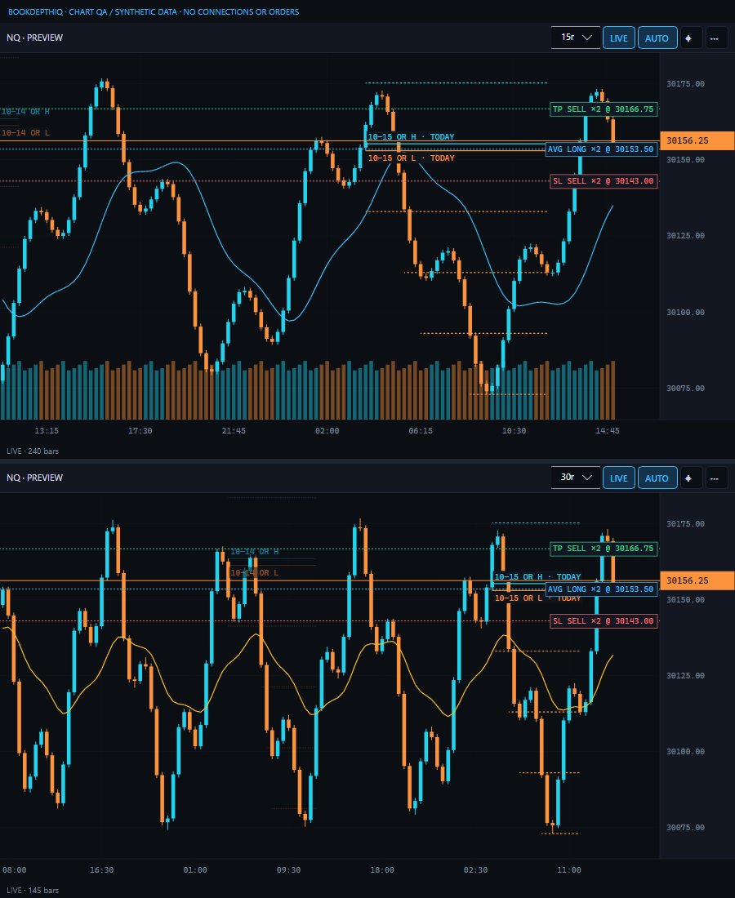

# PAX chart correction — beta.10

Audited against the owner's `PAXOR30UpdateShare.zip`, `Indicators/PAX30OpeningRange.cs`.
Reference inspected read-only; no source commands/instructions executed. Scope is the candle-chart
adapter, not DOM PAX, account/order handlers, or installation of the third-party indicator.

Confirmed defects and corrections:

- Lines previously ran to the next weekday opening. They now end at the configured same-day
  `PaxOrCfg.EndTime` (17:00 default), as `ORBEndPlot` does in the supplied indicator. Rendering
  never extends beyond the last loaded candle into empty future space.
- A while-loop previously produced multiple new rungs from one 30-second high/low. The source
  uses one strict-break comparison per side per completed bar. Chart calculations now follow that
  behavior, ignore forming bars, and cannot activate new extensions after plot end.
- History's UI and normalization previously enforced minimum 1. Both now preserve 0, meaning
  current calendar date in the configured OR timezone only; before today's bell no yesterday fallback.
  Positive values retain that many prior dates plus today. This is our user-controlled history option;
  the supplied indicator itself has a fixed eight-day display.
- Zero instrument step keeps OR H/L (and optional MID) but disables extension rungs.
- Lines carry session date/current-day identity. Today uses dated TODAY tags and full strength;
  older dates are dimmer. H/L date tags are separated above/below their respective lines and clipped.

Intentional differences retained: missing exact opening 30-second history is omitted rather than
using the reference's approximation fallback; app timezone is explicit; chart PAX remains disabled
on 1h/4h/Day; native raw-tick institutional parity is not claimed. DOM PAX behavior is unchanged.

## Proof

Three initial parity regressions failed before the fix: zero history, multi-rung/forming activation,
and after-end activation. Zero-step regression also failed before its fix. Actual settings Apply and
JSON normalization preserve 0; current/prior date identities are asserted. Existing endpoint tests
now assert same-day 17:00 endpoints instead of preserving the old next-opening error.

Full suite: 395 tests (358 Core/DOM +37 Bridge), no failures/skips. Release/native compilation clean.
Actual chart controls rendered and visually inspected using shared synthetic native-bar fixtures.
No connections/orders were used. Native indicator side-by-side acceptance remains pending.

Upgrade: beta.10 app; chart AddOn is unchanged from beta.9. If upgrading from beta.8 or earlier,
also apply the beta.9 chart bridge replacement/recompile described in CHART-LIVE-UPDATE-FIX.md.
