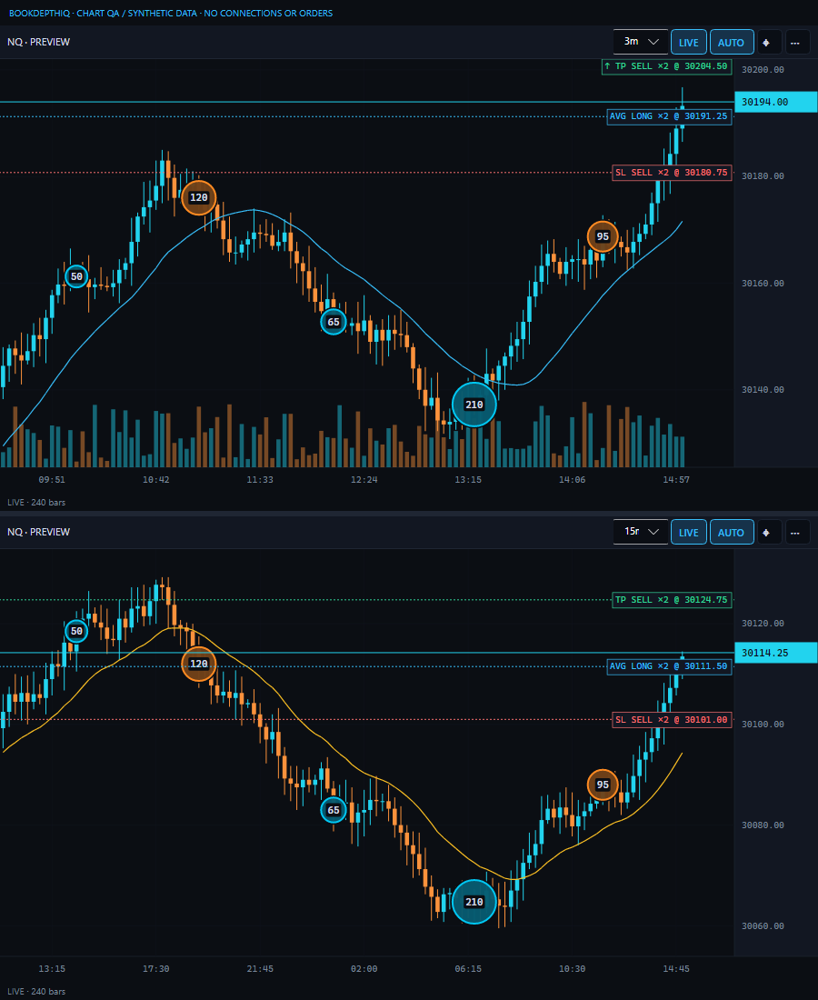

# Readable large-trade markers — beta.11 preview

Approved scope: improve marker/quantity readability without changing the trade threshold,
capture, order behavior, candle prices or DOM layout. Feature branch: codex/readable-trade-markers.

- New style: 24–48 DIP quantity-scaled circles, 40% colored fill, dark separation behind the
  marker and a stronger side-colored outline. Buy/sell/unknown colors remain user-controlled.
- All qualifying prints show exact quantities by default, including a threshold-sized 50-contract
  print. Numbers use 11-DIP semibold text over an opaque dark badge, never shrink to 6 DIP.
- Explicit Off/Large/All label settings still work. The old exact default combination
  (12/42 DIP,20% fill,Large labels) migrates once; threshold and colors are preserved.
  Customized style combinations are untouched. A persisted version prevents repeating migration
  after a user deliberately restores the old appearance through settings.
- Existing density/capture limits remain: bigger circles can omit more overlapping prints;
  omitted counts remain in coverage/hover. No quantities are merged or reconstructed.

Verification: threshold labels at 100/150/200% DPI, legacy migration/custom-style preservation,
JSON roundtrip/one-time migration, existing hover/navigation/no-order and autoscale tests.
Full suite: 400 passing (363 Core/DOM +37 Bridge). Release/native compile checks clean.
Actual previews inspected at900x1100 and380x1000 at200% DPI. Synthetic10,000-candle/50,000-print
fixture,60renders: p50 14.90ms,p95 18.42ms,79,430,640 managed bytes. Single local run, not a feed
latency guarantee. Native desktop acceptance not claimed; no installed files or orders changed.

Chart AddOn unchanged from beta.9/beta.10. Run the beta.11 app to use the appearance correction.
