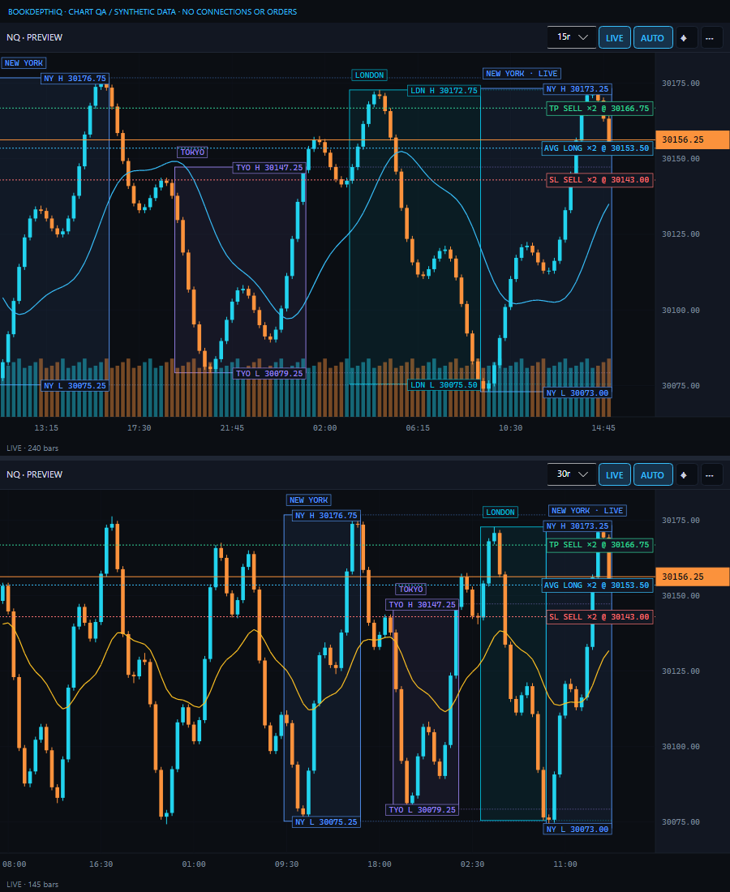

# Session zones — feature-branch verification

Tokyo, London and New York session ranges use native 30-second bars, named time zones,
integer-tick highs/lows and a shared read-only source with PAX. Initially OFF. Enable in
each chart's settings; customize hours, time zone, color, opacity, labels and extensions.
Day charts deliberately omit intraday zones. These are editable example windows, not an
exchange holiday calendar.

## Evidence (2026-10-15)

- Full suite: 385 passed (351 Core/DOM, 34 Bridge), zero failed/skipped.
- Release DOM and installed-DLL BridgeCheck builds: zero warnings/errors.
- Boundary, overnight, London/NY DST transition dates, truncated/gapped history,
  stale/forming bars and revisions tested. Invalid/ambiguous DST windows are omitted,
  with an explanation rather than a guessed UTC offset.
- Settings JSON/deep draft, Cancel, invalid Apply and Both panes tested.
- Coalescing worker rejects queued results after invalidation/disposal; 100 identical
  requests do not recalculate. Production request builder retains one shared PAX/session source.
- Actual-control image tests at 100/150/200% DPI and 320 DIP verify unchanged axis pixels
  and autoscale. Real pointer hover, wheel zoom and recenter tested with an empty Ticket sink.
- Independent whole-branch review found three correctness issues, all regression-tested
  RED→GREEN: stale forming bars fabricating LIVE progress, queued results surviving a source
  subscription reset/disconnect, and extension-only viewports losing H/L lines/hover.
  Added 27-overlapping-zone label tests at three DPI scales: no colliding rectangles, retained
  labels at true prices and preserved target-overlay pixels. Removing collision suppression
  made all three tests fail; restoring it passed the full suite.
- Actual previews inspected at 900x1100 and 320x1000 at 200% DPI. Fixtures are synthetic;
  their TP/SL lines are drawings, not orders. No native connections or orders used.
- Dense synthetic benchmark: 75,000 source bars, aggregated 15m/30m candles, 50,000 prints
  per pane, 60 renders at 800x1000. Zones ON p50 8.37 ms / p95 10.24 ms, 54,119,696 managed
  bytes; OFF p50 7.59 ms / p95 10.23 ms, 41,609,448 bytes. Single local run, not a latency SLA.

## Deliberate limits and decisions

- Any interior 30-second gap is PARTIAL, even if it was a legitimate no-trade interval:
  conservative labels avoid claiming complete coverage.
- Calculations are background/coalesced and admitted at most twice per second. Graphics can
  lag 500 ms; this is not an execution path or an HFT guarantee.
- Endpoints inside unproved candle-time gaps omit the box instead of inventing a horizontal
  position. Coverage/status remains in chart settings. Labels that cannot fit at the true
  price are omitted, never moved to a false price; order/current-price overlays draw above them.
- Existing checkout and manual Windows execution ledger retained; no additional worktree
  or product behavior change from that process choice.

## Native acceptance still required

The desktop-control helper failed initialization with Windows OS error 3 (kernel asset path).
No blind UI fallback was used. Provider/native parity, disconnection/reconnect and a long-running
owner soak remain unverified. This is a tested beta feature, not institutional/HFT certification.

Owner checklist: enable zones on a Sim101-connected chart without placing orders; compare
H/L to native 30-second history; switch contracts/timeframes; reconnect the feed; toggle PAX
and zones independently; check custom sessions across DST and restart persistence.

The feature was merged into main after the owner's testing approval on October 16, 2026,
including the subsequent beta.9 live-update and beta.10 PAX corrections. The published beta7
release remains unchanged. The acceptance limits above describe the recorded automated checks;
owner testing approval is not a claim of exhaustive provider/latency certification.

## Review disposition

No Critical findings. All four Important findings (including missing dense-label proof) addressed.
Deferred minors: isolated socket assertions for both PAX/session disable directions (production
request builder and existing ChartClient unsubscribe tests cover these separately); formatting of
compressed implementation files. No second reviewer was used after the test-first fixes.

Reviewer did not assess native runtime, final packaging/remote state or newly added documentation;
those are executor checks, with native acceptance explicitly still pending above. Conservative
PARTIAL/gap omission decisions stand. These limits prevent an institutional-grade certification claim.
